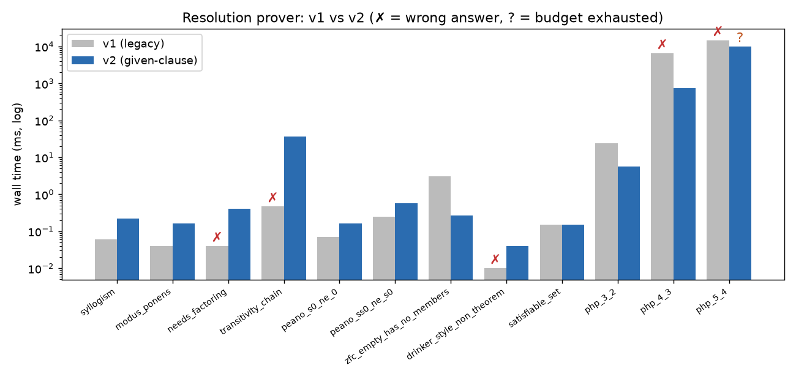
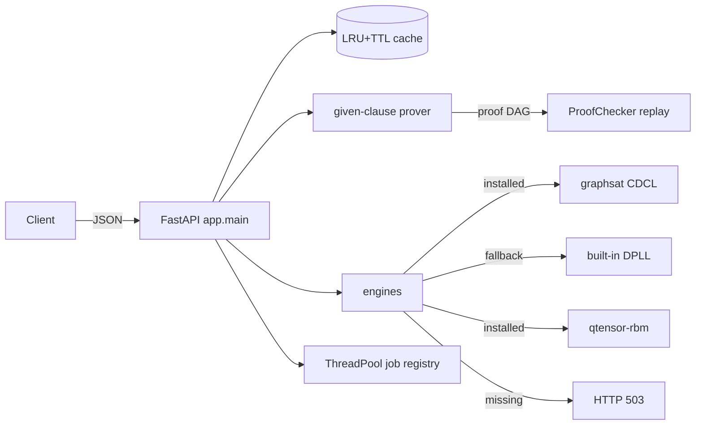

# Axiomatic Gateway

**A first-order resolution prover that checks its own proofs, served over a typed FastAPI gateway together with SAT, tensor-network and materials engines.**

[](https://github.com/Cyb0rg137ms/Axiomatic-Gateway-Scientific-Computing-API-Dashboard/actions/workflows/ci.yml)




*The plot above comes from `axiomatic bench --out docs/assets` on an 8-vCPU Linux VM with CPython 3.13. A ✗ marks a wrong answer; a ? marks a run that hit its budget.*

## Why it matters

When a theorem prover says "proved" for something false, it is worse than having no prover. The v1 code had three soundness or completeness bugs, all reproduced in `tests/test_v2.py`:

- **Wrong axiom-instance check.** The proof checker tested axiom instances with two-way unification, so it accepted `P(x)` as an instance of the axiom `P(a)`.
- **No Skolemization of the negated goal.** As a result, `p(a) ⊢ ∀X. p(X)` came back as **proved**.
- **No factoring, plus truncation.** Without factoring, refutable clause sets such as `{p(X)|p(Y), ~p(U)|~p(V)}` could not be refuted. The clause set was also silently cut off at 300 clauses, which turned "out of budget" into "false".

v2 changes how answers work:
- It returns `proved`, `saturated` or `unknown`; it never collapses these into a single boolean.
- It replays every proof through a step-checker before reporting `proved`.
- It never returns placeholder numbers. v1 returned constants such as entropy 80.5 or Tc 105 K whenever an engine was missing; v2 answers 503 instead.

## Key results

Reproduce with `pip install -e ".[dev]" && axiomatic bench --out docs/assets`. The full run takes 34.6 s.

| problem | expected | v1 answer | v1 ms | v2 status | proof re-checked | v2 ms |
|---|---|---|---|---|---|---|
| syllogism | proved | proved | 0.06 | proved | ✓ | 0.22 |
| needs_factoring | proved | **not proved ✗** | 0.04 | proved | ✓ | 0.40 |
| transitivity_chain (7 elems) | proved | **not proved ✗** | 0.47 | proved | ✓ | 36.75 |
| peano S(S(0)) ≠ S(0) | proved | proved | 0.25 | proved | ✓ | 0.57 |
| zfc a ∉ ∅ | proved | proved | 3.08 | proved | ✓ | 0.27 |
| p(a) ⊢ ∀X p(X) (non-theorem) | saturated | **proved ✗ (unsound)** | 0.01 | saturated | – | 0.04 |
| pigeonhole PHP(3,2) | proved | proved | 24.07 | proved | ✓ | 5.55 |
| pigeonhole PHP(4,3) | proved | **not proved ✗** | 6524.6 | proved | ✓ | 752.6 |
| pigeonhole PHP(5,4) | proved | **not proved ✗** | 14657.5 | unknown (10 s budget) | – | 10008.5 |

The full 12-problem table is in [`docs/assets/bench.md`](docs/assets/bench.md); raw numbers are in [`bench.json`](docs/assets/bench.json).

- **Speed on easy problems.** v2 is slower on trivial problems (about 0.2 ms against 0.05 ms). That cost comes from proof extraction, the re-check and subsumption.
- **Built-in DPLL fallback.** On random 3-SAT at m/n = 4.26, with 10 instances per size, the median times were:

  | n | median |
  |---|---|
  | 20 | 0.52 ms |
  | 30 | 1.53 ms |
  | 40 | 3.91 ms |
  | 50 | 7.99 ms |

  Every SAT model is checked against the clauses.
- **`/prove` latency.** Measured in-process with Starlette's TestClient over 200 requests:

  | | p50 | p95 |
  |---|---|---|
  | cold | 3.50 ms | 4.71 ms |
  | cache hit | 2.80 ms | 3.58 ms |

  Most of the cache-hit time is TestClient and serialization overhead, not proving.

## Architecture



The prover loop and the checker's acceptance rules are described in [docs/ARCHITECTURE.md](docs/ARCHITECTURE.md).

| module | role |
|---|---|
| `app/logic.py` | terms, clauses, unification, one-way matching, subsumption, factoring, Skolemization |
| `app/prover.py` | given-clause saturation (weight/age selection, tautology + forward-subsumption deletion) |
| `app/proof.py` | step checker (Axiom, Premise, Resolution, Factor, natural-deduction rules) and SLD back-chaining |
| `app/parser.py` | TPTP-style CNF syntax (`~p(X) \| q(f(X))`; uppercase = variable) |
| `app/sat.py`, `app/engines.py` | DPLL fallback and optional-engine adapters |
| `app/main.py`, `app/registry.py`, `app/cache.py` | HTTP API, background jobs, cache |

## 60-second quickstart

```bash
git clone https://github.com/Cyb0rg137ms/Axiomatic-Gateway-Scientific-Computing-API-Dashboard && cd Axiomatic-Gateway-Scientific-Computing-API-Dashboard
pip install -e ".[dev]"
axiomatic prove examples/socrates.cnf --goal "mortal(socrates)"
axiomatic serve          # http://127.0.0.1:8000/docs
```

```text
status: proved (empty clause derived); verified=True; 4 iterations, 0.8 ms
     0  mortal(X) | ~man(X)                      axiom
     1  man(socrates)                            axiom
     2  ~mortal(socrates)                        negated_goal
     3  mortal(socrates)                         resolution [0, 1]
     5  []                                       resolution [3, 2]
```

## Usage

**HTTP**

```bash
curl -s localhost:8000/prove -H 'content-type: application/json' \
  -d '{"axioms":["p(a)"],"goal":"p(X)"}'
# {"status":"saturated","verified":null,"iterations":2,...}

curl -s localhost:8000/solve/sat -H 'content-type: application/json' \
  -d '{"num_vars":3,"clauses":[[1,2],[-1,3],[-3]]}'
```

| endpoint | purpose |
|---|---|
| `GET /` | health check plus which engines are installed |
| `GET /metrics` | cache hits/misses and task counts |
| `GET /problems` | the built-in suite |
| `POST /prove` | `{axioms, goal?, timeout_s≤30, max_iterations}` |
| `POST /solve/sat` | GraphSAT if installed, otherwise DPLL |
| `POST /solve/quantum`, `POST /solve/materials` | real engine, or 503 if it is not installed |
| `POST /simulation` | `name: "prove" \| "sat"` runs a real background job; any other name creates a v1 manual-progress task |
| `GET /simulation/{id}` | poll a task |

**Python**

```python
from app.parser import parse_clauses, parse_clause
from app.prover import prove

res = prove(parse_clauses(["~lt(X,Y) | ~lt(Y,Z) | lt(X,Z)", "lt(a,b)", "lt(b,c)"]), parse_clause("lt(a,c)"))
print(res.status, res.verified, [str(d.clause) for d in res.proof])
```

Docker: `docker build -t axiomatic . && docker run -p 8000:8000 axiomatic`.

## Design decisions and trade-offs

- **Given-clause saturation instead of all-pairs rounds.** Each clause pair is resolved once. Selection is fair: lightest clause first, with every 5th pick taking the oldest. Together with factoring, that is what makes `saturated` a meaningful answer.
- **Self-checking over trusting the search.** Replaying a proof costs about 0.1 ms on small problems, but it catches prover bugs before a false "proved" reaches a client.
- **Tri-state results.** "Not proved within budget" (`unknown`) is a different fact from "not a theorem" (`saturated`), so the API reports them separately.
- **No mocks.** A missing engine returns 503. A predictable error is better than a plausible-looking but invented number.
- **Compatibility kept.** The v1 public API still works:
  - `DerivationEngine.prove_resolution` (now a wrapper around the new prover)
  - the `ProofChecker` rule set
  - the `/solve/*` routes
  - manual-progress `/simulation` tasks
  - `uvicorn app.main:app`

  The v1 prover is kept verbatim in `app/legacy.py` as a benchmark baseline.

## Limitations and roadmap

The details are in [docs/LIMITATIONS.md](docs/LIMITATIONS.md). In short:
- There is no equality reasoning (no paramodulation) and no ordered resolution or term indexing.
- The pigeonhole problem PHP(5,4) does not finish in 10 s.
- The API has no authentication or rate limiting, and its state lives in a single process.

Roadmap:
- ordered resolution with literal selection
- discrimination-tree indexing for subsumption
- paramodulation
- TPTP problem-file import
- persistent job store

## Citation

```bibtex
@software{axiomatic_gateway_2026,
  author  = {Cyb0rg137ms},
  title   = {Axiomatic Gateway: a self-verifying resolution prover and scientific-computing API},
  year    = {2026},
  version = {2.0.0},
  url     = {https://github.com/Cyb0rg137ms/Axiomatic-Gateway-Scientific-Computing-API-Dashboard}
}
```

## License

MIT. See [LICENSE](LICENSE).
