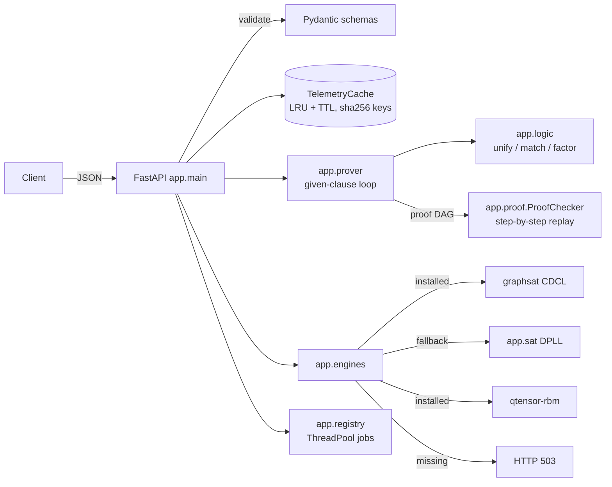
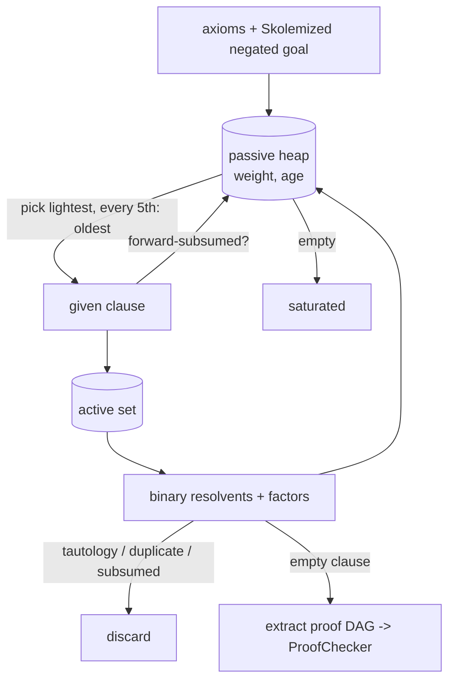

# Architecture

## Given-clause loop (`app/prover.py`)

Every `proved` answer is replayed by `ProofChecker`. It accepts:
- an axiom step only if the clause is an exact instance of an axiom (one-way matching);
- a resolution or factor step only if a resolvent or factor subsumes the stated clause.
